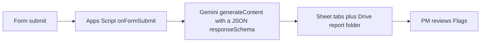

# Field-to-Office

Foremen's daily reports arrive as free text, paper, or photos on a phone, so PMs retype them while possible change orders are noticed late and
material shortages are found on site. Field-to-Office, a demo for the Operational System Applications & AI Manager application at United Electric
Company, turns each daily report into a Job Log, crew hours, and a Drive report folder, and flags possible change orders and material shortages for
PM approval.

> **Demo video:** _link to be added by Cosmo_
>
> **Live Sheet (view-only):** _link to be added by Cosmo_

Jobs, people, and reports in this repo are fictional. Domain terms follow [docs/GLOSSARY.md](docs/GLOSSARY.md). Product intent is in [docs/prd.md](docs/prd.md).

## How it works

One Apps Script project is bound to one Google Sheet and runs in a personal Google account. [ADR 0002](docs/adr/0002-apps-script-in-workspace.md) chooses that shape because it matches a Google
Workspace stack, so a Workspace admin could adopt the pattern with the tools already in that stack. For a production daily log, the same ADR names a
buy evaluation of Procore or Raken, scored against this pilot. The current-state and future-state maps are in [docs/process-maps.md](docs/process-maps.md). Components are listed in [docs/architecture.md](docs/architecture.md).

- A foreman submits the Form "Field-to-Office Daily Report" from a phone: Job, Foreman name, Report date, and Report text, plus optional Photos
  and a Voice note. A blank Report date means the submission date in America/New_York ([ADR 0001](docs/adr/0001-google-form-intake.md)).
- The installable `onFormSubmit` trigger calls `onReportSubmit`. The script waits up to 30 seconds for a script lock, then appends the Job Log row first with status
  Processing, so the daily report is kept even when the lock is not acquired. On a known job it then moves uploads into the report folder.
- The report folder is `Field-to-Office Demo/Jobs/<Job #> - <Job Name>/Daily Reports/<date>/`.
  A file name is the date, job number, foreman, and index, as in `2026-11-03_J-2401_<foreman>_1.jpg`.
  The foreman name keeps letters, digits, and hyphens; spaces become hyphens.
- The script calls Gemini `generateContent` with the report text and inline photos and audio. The default model is `gemini-3.5-flash-lite`. The request sets `responseMimeType` to JSON and a `responseSchema`
  for summary, crew, total hours, work completed, issues, possible change orders (with an evidence quote), material shortages, and confidence.
  Attachments whose total size is over 15 MB stay filed in Drive; that call sends text only and notes `attachments skipped: size`.
- A response that matches the schema sets the daily report to Processed, writes Crew Hours, and writes Flags at Pending. An HTTP error, invalid
  JSON, a blocked response, or a schema mismatch sets status to Needs review, stores the reason and the raw output, and writes no crew or flag
  rows.
- The PM reviews each flag and sets Approved or Rejected. The Dashboard tab is formulas, so it changes when the other tabs change ([ADR 0005](docs/adr/0005-sheets-dashboard-tab.md)).



The diagram is the path a PM follows. In the script, the Job Log row is appended before the model call. On a known job, uploads move into the report
folder before `generateContent` returns. Crew Hours, Flags, and status Processed are written after a valid JSON body.

Offline tests fake Spreadsheet, Form, Drive, and UrlFetch. The latest `node --test` result recorded in the [F001 test report](docs/features/F001-daily-field-report/TEST_REPORT.md) is 41 passed and 0 failed. AT9, AT10, AT11,
AT13, and AT14 passed offline. Live acceptance tests AT1 through AT8 and AT12 are pending (that report marks them UNKNOWN). The 2026-11-03 notes in
that report are operator-reported, and a live Form submission with a photo and a voice note has not been run.

## Tab-by-tab tour

Column names, types, and fictional examples are in [docs/data-dictionary.md](docs/data-dictionary.md).

- **Job Log.** One row per daily report: report id, dates, job, PM, foreman, the original text, the extraction (summary, hours, work completed,
  issues, confidence, file links), and status Processing, Processed, or Needs review.
- **Crew Hours.** One row per crew member on that report: name, classification, and hours from the extraction. Classifications use titles such as
  Foreman, Journeyman Wireman, and Apprentice.
- **Flags.** One row per possible change order or material shortage. Status is Pending, Approved, or Rejected; the PM decides, and types PM Note,
  Reviewed By, and Reviewed At. A change order keeps the foreman's evidence quote.
- **Dashboard.** Formulas only (FILTER, QUERY, COUNTIF): today's reports, hours by job, open flags, and the pilot scorecard. Est. minutes saved
  multiplies processed reports by the input cell Minutes saved per report, which is 15 and labelled "Assumption, not measured".
- **Jobs.** Config written by `setup()`: Job #, Job Name, PM, Drive Folder ID, and Active. The Form's Job dropdown is built from these rows, and setup
  seeds three fictional jobs.

Those jobs are J-2401 Riverside Medical Office Bldg - Tenant Fit-Out, J-2402 Harbor Logistics Warehouse - Service Upgrade 2000A, and J-2403
Northgate Elementary - Fire Alarm Replacement. The PM and foreman names on them are fictional and are listed in the data dictionary.

## Setup

Permissions, the uninstall steps, and the longer click-path are in [SETUP.md](SETUP.md). The behavior contract is the [F001 spec](docs/features/F001-daily-field-report/SPEC.md). Use a personal Google account. Put only
fictional jobs, names, photos, and daily reports into the Form.

1. Create a blank Google Sheet named Field-to-Office, then open Extensions → Apps Script so the project is bound to that Sheet.
2. Paste this repo into the bound project: `App.js` into a file named `App`, `Logic.js` into a file named `Logic`, and replace `appsscript.json` with the manifest from this
   repo. Save every file. `clasp push` is an optional alternative (`.claspignore` keeps tests and docs out of the Apps Script project).
3. Run `setup()` from the Field-to-Office menu (Setup), or select the `setup` function in the editor and run it, and approve the prompts. Setup sets the
   time zone to America/New_York, creates the five tabs, writes three sample jobs, creates the Drive tree and the Form, installs one `onFormSubmit` trigger
   for `onReportSubmit`, and writes the Dashboard formulas. A second run creates no duplicate tabs, folders, form, or trigger. Setup still finishes when `GEMINI_API_KEY`
   is absent, and the alert explains how to add it.
4. Add the Photos and Voice note file-upload questions by hand, because Apps Script cannot create them. In the Form editor, add `Photos` (file upload,
   images only, multiple files, maximum 10, optional) and `Voice note` (file upload, audio only, one file, optional). Leave Job, Foreman name, Report
   date, and Report text as `setup()` created them. Anyone who uploads a file signs in to a Google account.
5. In the Apps Script editor, open Project Settings → Script properties and add the key. The Gemini key goes only in Script Properties as `GEMINI_API_KEY` and
   never in the repo, the Sheet, or the script files. Optional property `GEMINI_MODEL` overrides the model id; leave it unset and the script calls `gemini-3.5-flash-lite`
   ([ADR 0006](docs/adr/0006-gemini-model-3-5-flash-lite.md)).
6. Optionally run `loadSampleReports()` from the menu item Load sample reports. It sends three fictional text-only sample reports, one per job, through the same
   pipeline, with Source set to Sample, and skips a sample whose text is already on the Job Log. Run this after the key is set. With no key, each
   sample is still logged and its status is Needs review.

## Safeguards

- **Human approval on every flag.** The model only raises a flag. Each one is a possible change order or a material shortage, and it stays Pending
  until a PM sets Approved or Rejected. PM Note, Reviewed By, and Reviewed At start blank for the PM to type. Approving a flag sends no email and
  creates no file. That human-in-the-loop rule is [ADR 0004](docs/adr/0004-human-in-the-loop-flags.md).
- **Fictional data only.** This pilot uses an AI Studio key. Those terms may let Google use inputs to improve its products, so the jobs, names,
  photos, and daily reports in the demo are fictional.
- **No secrets in the repo.** The Gemini key goes only in Script Properties as `GEMINI_API_KEY` and never in the repo. Acceptance test AT14 greps the tree for
  a key pattern and records no match. Folder and Form ids used for a second setup (`FTO_ROOT_FOLDER_ID`, `FTO_FORM_ID`) are Script Properties too.
- **Reports that fail AI parsing go to Needs review instead of being guessed.** The Job Log row is already there. Status becomes Needs review,
  Errors holds the reason, Raw AI Output keeps the body (truncated to 45,000 characters), and that report gets no Crew Hours or Flags rows. A row
  left on Processing means the run stopped early; the usual cause is the 6-minute Apps Script limit, and someone checks that row by hand.
- **Confidence is shown, not used to gate.** The model's 0 to 1 self-rating is the Job Log column Confidence. A low value does not hold back a
  daily report, and it does not approve or reject a flag. A confidence outside 0 to 1 is a schema mismatch, so the report goes to Needs review.
- **Vertex AI is the production path.** The demo calls the Gemini API with one Script Property so it can run on a personal account. [ADR 0003](docs/adr/0003-gemini-multimodal-extraction.md) keeps
  Vertex AI for production: enterprise terms, no training on data, regional control, and IAM. A move to Vertex changes the endpoint and the auth.
  The `responseSchema` stays. [ADR 0006](docs/adr/0006-gemini-model-3-5-flash-lite.md) confirms that production choice.

What may go into the model, what must stay out, the human-review rule, and the pilot scorecard are in the [AI use policy and scorecard](docs/ai-use-policy-and-scorecard.md). The scorecard targets in that
document are illustrative and are set with PMs before a pilot. The policy's "minutes saved per report" figure is the same 15-minute assumption,
labelled as unmeasured until a PM time study exists.

## Repo layout

```
.
├── App.js
├── Logic.js
├── appsscript.json
├── .claspignore
├── README.md
├── SETUP.md
├── test/
│   ├── f001.test.js
│   └── logic.test.js
├── testing/
│   └── fakes.js
└── docs/
    ├── GLOSSARY.md
    ├── prd.md
    ├── architecture.md
    ├── data-dictionary.md
    ├── process-maps.md
    ├── ai-use-policy-and-scorecard.md
    ├── CHANGELOG.md
    ├── adr/
    │   ├── 0001-google-form-intake.md
    │   ├── 0002-apps-script-in-workspace.md
    │   ├── 0003-gemini-multimodal-extraction.md
    │   ├── 0004-human-in-the-loop-flags.md
    │   ├── 0005-sheets-dashboard-tab.md
    │   └── 0006-gemini-model-3-5-flash-lite.md
    ├── features/
    │   ├── .gitkeep
    │   └── F001-daily-field-report/
    │       ├── HANDOFF.md
    │       ├── SPEC.md
    │       └── TEST_REPORT.md
    └── test-plans/
        └── .gitkeep
```

`App.js` holds the bound-script entry points (`setup`, `onReportSubmit`, `loadSampleReports`) and the Google service calls. `Logic.js` holds row shapes, the Gemini request, and the `responseSchema`. `testing/fakes.js`
stands in for Spreadsheet, Form, Drive, and UrlFetch when `node --test` runs. `appsscript.json` sets America/New_York, the V8 runtime, and the scopes the script calls.

## How the team works

Each feature lives in `docs/features/<id>/`. The planner writes `SPEC.md`. The engineer writes the code and `TEST_REPORT.md`. `HANDOFF.md` is an append-only log of each step. Decisions that
should outlive one feature are ADRs in `docs/adr/`. Code and docs reach `main` by pull request, and Cosmo approves the merge.

- Planner: blueprint writes the spec and the ADRs. The F001 spec names this role planner.
- Engineer: forge writes `App.js`, `Logic.js`, and the test report. The F001 spec names this role builder.
- Coordinator: Groko carries confirmations and the operator-reported live run back to Cosmo, who approves merges.

F001, the daily field report, is the feature in the repo: [SPEC](docs/features/F001-daily-field-report/SPEC.md), [test report](docs/features/F001-daily-field-report/TEST_REPORT.md), [handoff](docs/features/F001-daily-field-report/HANDOFF.md).
