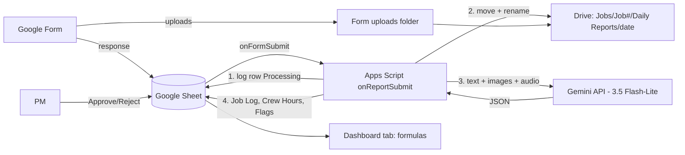

# Architecture: Field-to-Office

One Apps Script project bound to one Google Sheet, running in Cosmo's personal (consumer, non-Workspace) Google account. There are no servers.

## Components
1. **Google Form:** the foreman's intake. Responses go to the Sheet, and uploads go to the Form's Drive folder.
2. **Apps Script trigger:** an installable spreadsheet `onFormSubmit` calls `onReportSubmit(e)`. It logs the row first, files the uploads, calls Gemini, and writes the results.
3. **Gemini (`gemini-3.5-flash-lite`, ADR 0006):** a REST call with inline text, images, and audio that returns schema-checked JSON. The key is in Script Property `GEMINI_API_KEY`.
4. **Google Sheet:** the tabs Job Log, Crew Hours, Flags, Dashboard (formulas), and Jobs (config).
5. **Google Drive:** a per-job folder tree, with renamed files under `Daily Reports/<date>/`.

Details: [SPEC](features/F001-daily-field-report/SPEC.md) · [Data dictionary](data-dictionary.md)

## ADRs
- [0001 Google Form intake](adr/0001-google-form-intake.md)
- [0002 Apps Script in Google Workspace tools (build vs buy)](adr/0002-apps-script-in-workspace.md)
- [0003 Gemini multimodal extraction](adr/0003-gemini-multimodal-extraction.md)
- [0004 Human-in-the-loop flags](adr/0004-human-in-the-loop-flags.md)
- [0005 Sheets dashboard tab](adr/0005-sheets-dashboard-tab.md)
