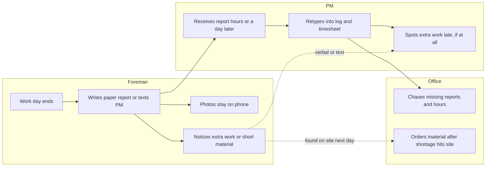
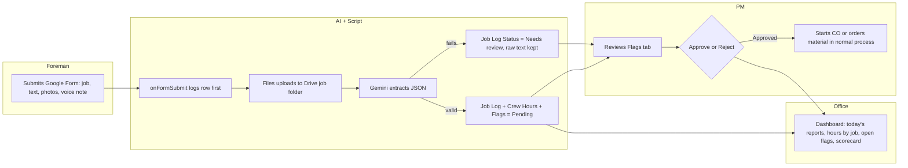

# Process maps: daily field report

We mapped this process before automating it. The automation follows the future-state map, not the other way round.

## Current state

**Pain points**
- Paper and text reports arrive late and in different formats.
- The PM spends about 15 min per report retyping (an illustrative estimate).
- Photos stay on personal phones, so there's no job record and no evidence for change orders.
- Extra work is noticed late, so change orders are submitted late or never, and revenue is lost.
- Material shortages are found on site, which means idle crew and rush orders.
- Crew hours are re-entered by hand, which invites payroll errors.

**Swimlanes:** Foreman, PM, Office. There is no system lane.

## Future state

**Improvements**
- One structured form from any phone. The job is picked from a list, not guessed.
- No retyping: summary, hours, and work items fill in automatically.
- Photos and voice notes are filed by job and date with standard names.
- Possible change orders and shortages are flagged the same day, with the foreman's own words as evidence.
- The PM approves every flag. Nothing goes out automatically.
- Failed AI runs are still logged, so no report is lost.
- The scorecard shows whether the pilot is worth keeping.

**Swimlanes:** Foreman, AI + Script, PM, Office.
